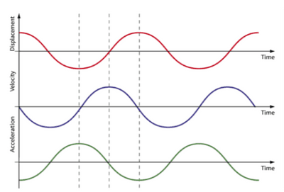

## Graphs of Simple Harmonic Motion

**Characteristics of the Graph:**

* At each end of the oscillation, when the velocity is momentarily zero, the displacement curve is a maximum, positive or negative (A or – A), and its gradient = 0.
* At the centre of the motion, corresponding to x = 0, the velocity has its maximum value – you can see from the graph for x that the gradient, and hence the velocity, is a maximum at each point where the curve crosses the t-axis; furthermore, the gradient alternates between being positive and negative as the body moves first one way, and then back again, through the mid-point of its oscillations.
* Note that the displacement-time graph shows a sin graph, whereas the velocity-time graph is a cos graph. The velocity-time graph is also 90 degrees out of phase with the displacement-time graph.
* You must understand these graphs if asked to analyse them during the exam.