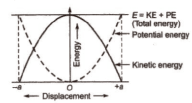

## The Energy of Simple Harmonic Motion

* As a pendulum swings to and fro, there is a continuous interchange of kinetic and gravitational potential energy. At one end of its swing, the pendulum momentarily rests, so its kinetic energy is zero.
* At this point, it will have maximum potential energy because the bob is at its highest point. As the bob swings down, it loses gravitational potential energy and gains kinetic energy.
* At the bottom of the swing, the midpoint of motion, the bob will have maximum velocity and, thus, maximum kinetic energy. As this is the lowest point of its motion, its gravitational potential energy will have its minimum value.
* This cyclic interchange of energy is repeated twice every oscillation.
* At any point, the particle has both potential energy and kinetic energy. The total energy remains constant. This is according to the Principle of Conversation of Energy.
* **Total Energy = Kinetic Energy + Potential Energy**