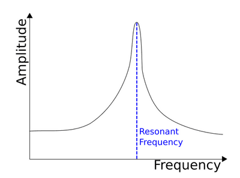

## Resonance

* If a system or object is forced to vibrate at its natural frequency, it will obtain the maximum energy, and the amplitude of the oscillations will reach its maximum.

* In this case, it is said to be in resonance

**Uses of Resonance:**

* Instruments - An instrument such as a flute has a long tube in which air resonates, causing a stationary sound wave to be formed.

* Radio - These are tuned so that their electric circuit resonates at the same frequency as the desired broadcast frequency.

* Swing - If someone pushes you on a swing, they provide a driving frequency, which can cause resonance if it’s equal to the resonant frequency and cause you to swing higher.

* **Negative Consequences of Resonance:**

  * **Damage to a structure**

    When many people walk on a bridge, they will provide a driving frequency similar to the bridge's natural frequency. It will begin to oscillate violently, which could be very dangerous and damage the bridge.

* The effects of resonance can be reduced by means of damping. If there is damping, the resonant frequency at which the amplitude is a maximum is lower than the natural frequency, and this difference increases as the degree of damping increases.

* As the amount of damping increases, the resonant peak is much lower, and the resonance curve broadens out. Damping can be achieved using a material that absorbs energy from the oscillation (energy is transferred into the object's internal energy), or the plastic deformation of ductile materials can achieve it.