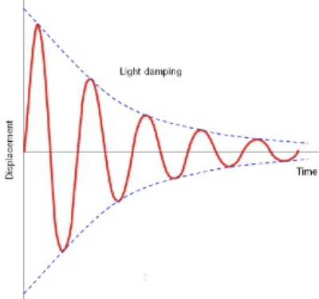
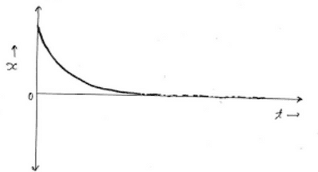
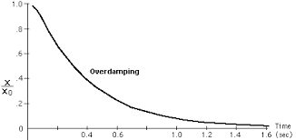
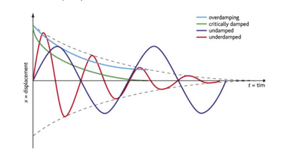

## Free, Damped and Forced Oscillations

* **A Free Oscillation** is one in which no external force acts on the oscillation system except the force that gives rise to the oscillation.

* **A Damped Oscillation** is one in which energy is transferred to the surroundings, resulting in reduced amplitude and energy oscillations. An oscillation system does work against external forces acting on it, such as air resistance, and so uses up some energy. This transfer of energy from the oscillating system to the internal energy of the surrounding air causes the oscillations to slow down and eventually die away.

* **Forced Oscillations** occur if a force is repeatedly or continually applied to keep the oscillation going so that the system is made to vibrate at the frequency of the vibrating source and not at its own natural frequency of vibration.

  **The amplitude of the forced oscillation system depends on the following:**

  * The natural frequency of the system
  * The frequency of the applied force
  * The phase difference between the applied force and the nature of vibration
  * The magnitude of the applied force
  * The magnitude of the resistive force

### **Damping It For More Detail**

* The system's total energy decreases if a resistive force acts on a vibrating or oscillating system. This effect is known as damping.
* Thus, the amplitude of oscillation decreases. This form of oscillation is called damped oscillation.
* The degree of damping depends on the magnitude of the resistive force. In terms of resistive force, damping can be classified into three types:

**Light Damping**

* This form of damping occurs due to a small resistive force. Because of this force, the system's energy slowly decreases, and the amplitude of the oscillation decreases exponentially.
* ln case of light damping, the oscillation frequency remains constant. The object passes through the equilibrium, oscillating many times before coming to rest. Thus, it undergoes simple harmonic motion.

**Critical Damping**

* ln this case, the magnitude of the resistive force is sufficient to bring the system to rest at its equilibrium position in the shortest possible time. Since the system does not pass through the equilibrium position, acceleration is not proportional to displacement.
* It is not executing simple harmonic motion. Critical damping causes the most damping because it helps to achieve stability within the shortest possible time.

**Over Damping**

* ln this case, a large resistive force acts on the system, and it takes a longer time to reach the equilibrium position.

**Comparison of the types of damping:**

