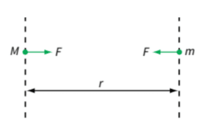

## Newton’s Law of Universal Gravitation

* This law states that any two point masses attract each other with a force that is directly proportional to the product of their masses and inversely proportional to the square of their separation.
* The formula is $F = \frac{GMm}{r^2}$
* The **gravitational constant** $G$ is sometimes referred to as the universal gravitational constant, which has a value of $6.67 \times 10^{-11} N m^2 kg^{-2}$

