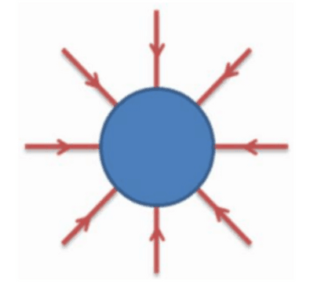
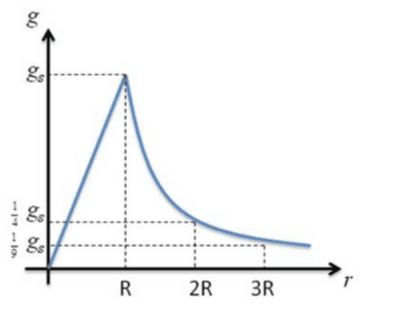

## Gravitational Field due to a Unit Mass

* Any mass will generate a gravitational field that will exert a force on any mass within the field. As gravity is always attractive, the field produced by a point mass will be radial in shape, and the field lines will always point towards the mass.

### **Formula Derivation**

Since $g = \frac{F}{m}$ and $F = \frac{GMm}{r^2}$

$g =\frac{ \frac{GMm}{r^2}}{m}$

* Simplify this equation, and we get:

$$

g = \frac{GM}{r^2}

$$

* The graph below shows how g varies with distance from the centre of a large spherical object (e.g. a planet) of uniform density.

* Since force is a vector quantity, gravitational field strength is also a vector. We need to give its direction and magnitude to specify it completely.
* The field strength g is not a constant; it decreases as the distance r increases.
* The field strength obeys an inverse square law with distance. The field strength will decrease by a factor of four when the distance from the centre is doubled. Close to the Earth’s surface, the magnitude of $g$ is about 9.81$Nkg^{-1}$. Even if you climb Mount Everest, which is 8.85km high, the field strength will only decrease by 0.3%.