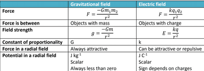

## Comparing Electric Fields and Gravitational Fields

* Make sure you learn the contents of this table and the bullet points below because the examiner might want you to elaborate on this

**Differences:**

**Similarities:**

* Both follow electrostatic force and gravitational force follow the inverse square law
* The field lines around a spherical mass and spherical charges are radial
* The field lines in a uniform electric and gravitational field are always parallel and equally spaced
* Gravitational and electric field strength both follow a $\frac{1}{r^2}$ relationship in a radial field
* Gravitational potential and electric potential both have a $\frac{1}{r}$ relationship