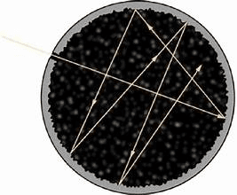
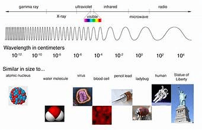

## Black-Body Radiation

* A **black-body** radiator is a theoretical body which is a perfect absorber and emitter of electromagnetic radiation.

* Imagine a cavity with one tiny hole in one side, and the hole itself is the black body which absorbs all the radiation that lands on the hole, as it goes into the cavity and bounces around with no chance of escaping out of the hole.

* There is no radiation being reflected. Hence, it is called “black body”

* All objects will emit electromagnetic radiation, but remember the EM spectrum. Not all types of radiation are visible to the human eye

* Infrared cameras are capable of detecting radiation from our bodies, but with our eyes, we can only see visible EM radiation from hot objects, such as the red glow of fire.

* All stars are black-body radiators