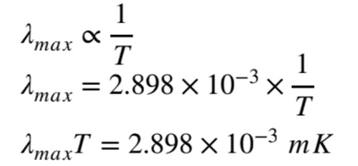
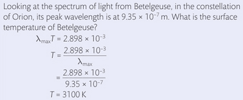

## Wien's Law

* **Wien’s Law** states that the peak wavelength $\lambda_{max}$ is inversely proportional to the surface temperature.

* 2.898 x $10^{-3} mK$ is **Wien’s displacement constant**

* **Calculations:**

