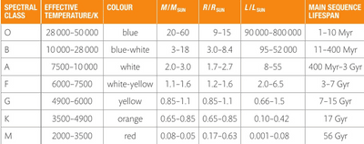

## Star Classes

* A star is a sphere in the outer space that can produce its own energy through nuclear fusion, as learnt in Topic 9
* Hydrogen and helium are the two main elements that form a star
* The colour of a star depends on its temperature. As a general rule of thumb, a blue star is the hottest, whereas a red star is the coolest
* This is in conjunction with **Wien’s Law**, $\lambda_{max}T = 2.898$ x $10^{-3} mK$. This tells us that the temperature determines the spectral output
* Scientists have classified stars into different spectral classes according to this table. You do not have to memorise this table for the exam

**Trends:**

* The higher the temperature, the greater the mass of the star
* The higher the temperature, the higher the luminosity of the star