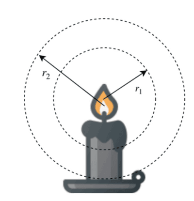

## Linking Luminosity and Radiation Intensity

* **Luminosity** is the power output of a star denoted in Watts, $W$

* **Radiation flux/intensity** is the luminosity per unit area and is denoted in $Wm^{-2}$

* Thus linking these two together gives us $F = \frac{L}{4\pi d^2}$ for a sphere, where $F$ represents the flux

* $L$ is a constant value because the power output of the star never changes. Therefore, the flux only depends on the distance. This is another example of **inverse square law**.