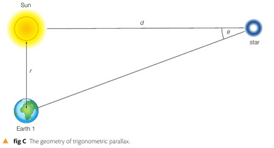
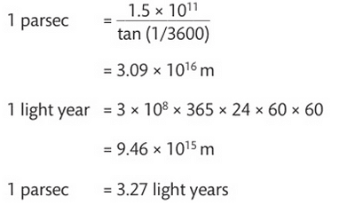
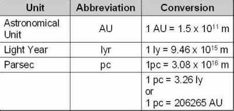

## Measuring Astronomical Distances

### **Trigonometric Parallax**

Astronomers use a method commonly used in surveying known as trigonometric parallax to measure the distance to relatively close stars.

* As the Earth moves around the Sun, a relatively close star will appear to move across the background of more distant stars. This optical illusion is used to determine the distance of the star.

* The star itself does not move significantly during the course of the observations. To determine the trigonometric parallax, measure the angle to a star and observe how that changes as the position of the Earth changes.

* We know that in six months, the Earth will be on the opposite side of its orbit and will be two astronomical units from its location today.

* Using observations of the star to be measured against a background of much more distant stars, we can measure the angle between the star and the Earth in these two different positions in space, six months apart.

* As we know the size of the Earth’s orbit, geometry allows the calculation of the distance to the star.

$tan\theta = \frac{r}{d}$

$d = \frac{r}{tan\theta}$

Using small angle approximations, $tan\theta \approx \theta$

Thus

$$

d = \frac{r}{\theta}

$$

* Parsec (pc) is a measure of distance, also known as “parallax second”.

* It is the distance a star must be from the Sun for the angle Earth-star-sun to be 1 arcsecond.

 

* Distance in parsecs can be obtained from $d = \frac{1}{\theta}$

* Summary of Conversions:

### **Standard Candles**

* Standard Candles are stellar objects of known luminosity.

* A standard candle’s brightness (radiation flux) on Earth is measured or known.

**The inverse square law is used**

$$

F = \frac{L}{4\pi d^2}

$$

* Distance to the standard candle is calculated.

* Cepheid stars are an example of standard candles. These stars have a luminosity which varies periodically.

**The process of finding the distance to a Cepheid Star is:**

* Locate the Cepheid variable star.
* Measure its period $T$.
* Find the star’s luminosity $L$.
* Measure the radiation flux (brightness) F from the star on Earth
* Calculate $d$ using = $\sqrt{\frac{L}{4\pi f}}$