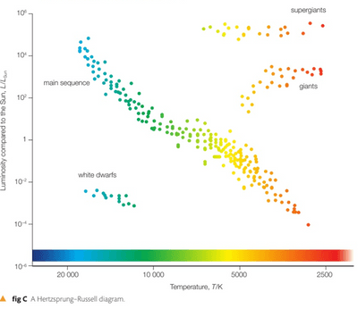

## Hertzsprung-Russell Diagram

* **The H-R diagram** is a plot of stellar luminosity against surface temperature. Note it is a diagram, not a graph – each dot represents a single star. To understand the diagram, remember what the two axes tell you.
* The vertical axis is luminosity, scaled in Sun-powers, i.e. multiples of $L$. The positions of the stars go up and down from 1 in powers of 10, i.e. the scale is logarithmic. The Sun’s luminosity $L = 3.90 \times 10^{26}W$.
* The horizontal axis is the surface temperature $T$ of the star in Kelvin. This scale is also logarithmic and goes from high temperature on the left to low temperatures on the right.

* It would be best to learn where the clusters of white dwarfs, main sequence, giants and supergiants are located in this diagram.
* You will be expected to sketch this in the exam.