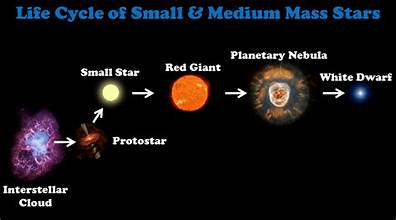
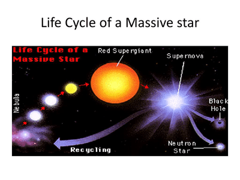

## The Life Cycle of Stars

* Stars have a limited lifespan
* The star's lifespan depends on the quantity of hydrogen in the star's core.
* Once the hydrogen runs out, the star will die
* When a star dies, it will take on different forms depending on its mass
* As the star undergoes nuclear fusion, the binding energy differences of the nuclei before and after fusion mean that the process releases energy, often as electromagnetic radiation, to heat the star. 
* The pressure from the vibration of its particles and the electromagnetic radiation trying to escape hold up the structure of the star against gravitational collapse. 
* This constant battle between outward pressure and gravity drives a star's evolution throughout its lifetime. The star's initial mass is a critical factor in determining how the battle wages and, thus, which of the possible life cycles a star will follow.

### **Low-Mass Stars (Life Cycle of Our Sun)**

* **Stage 1**: The Sun was formed or born from a cloud of hydrogen and helium.
* **Stage 2 (current stage)**: The Sun joins the main sequence stars as it undergoes nuclear fusion of hydrogen, converting it into helium.
* **Stage 3**: Eventually, the Sun will run low on hydrogen fuel but will have produced so much energy that it will expand slightly. This expansion causes the temperature to fall, and the star becomes a red giant. Once most hydrogen fuel is used, the star will start fusing helium nuclei. This complex process can cause an explosion that throws some material from the star out into space, forming a planetary nebula. As the fuel to produce energy to support the star runs out, the outward pressure from fusion drops, and gravity takes hold, causing the star to contract to a much smaller size. This heats significantly, and it becomes a white dwarf.
* **Stage 4 (theoretical**): As time continues, the star will slowly run out of energy and die, passing through the red dwarf stage to become a black dwarf.

**Going back to the H-S diagram:**

* **Main sequence stars:**
  * Fusion of hydrogen atoms into helium nuclei
  * Constant size
* **Red giants**
  * Fusion of helium nuclei and formation of heavier elements
  * Loss of material into space and formation of a planetary nebula
  * Decrease in size and increase in temperature leading to the formation of white dwarfs
* **White dwarfs:**
  * White dwarf stars are the core remnant of a red giant star

  * There is no fusion going on in the white dwarf

  * They have a small surface area, so they are not very luminous

    They are very hot and appear white (because they emit all visible wavelengths)

### **Massive Stars**

* If a protostar has more than four times the mass of our Sun, the star begins life as a blue supergiant.
* As with low-mass stars, nuclear fusion begins, and the star enters a stable stage of life in which heat pressure and gravity are in equilibrium. However, the fusion processes happen at much higher temperatures than in lower-mass stars. This means that it burns very quickly, and the conditions make it possible for further fusion of some of the larger atoms it produces to occur.
* The fusion of helium can produce a variety of larger elements. When the material of such a star has been fused to the point where it is mostly iron, it can no longer undergo nuclear fusion and stops producing energy. With the enormous gravitational forces produced by the large mass, the star undergoes an incredible collapse.
* This sudden increase in density produces a sudden huge burst of energy, effectively bouncing the collapse back out.
* This explosion is a supernova, the most immense energy ever witnessed. Within a supernova explosion, there is so much energy that nuclear reactions occur, which produce the elements above iron in the periodic table.
* The natural occurrence of these elements is evidence that supernovae must have occurred in the past, as the binding energies of these heavy elements are such that they cannot be created in other natural processes in the Universe.
* After a high-mass star has exploded as a supernova, the entire star may be completely shattered. If a central core of stellar material remains, this will either be a neutron star or a black hole.
* A neutron star consists almost entirely of neutrons packed as densely together as the nucleons within the nucleus of an atom.
* Black holes are even smaller and hold even more matter than neutron stars. This means that their gravitational pull is immense – so strong that even things travelling at the speed of light cannot escape.