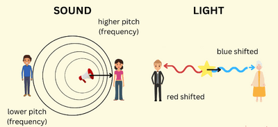
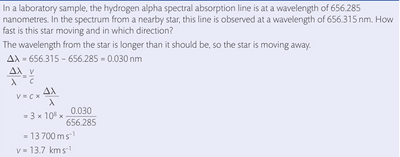

## The Doppler Effect

* Here, we see how astronomy relates to waves

* The Doppler effect is the shift in the frequency of a wave in relation to an observer due to the relative motion of the observer and the wave source

* Supposedly, the wavefronts would all be equal when the wave source is stationary.

* However, the frequency increases if the wave source moves towards the observer. This is because the wavefront bunches up and creates shorter wavelengths, leading to higher frequencies.

* If the wave source moves away from the observer, the opposite occurs - the wavefronts separate out and create longer wavelengths and shorter frequencies.

* In light, a redshift is an increase in the wavelength (refer to the diagram above) and a corresponding decrease in the frequency and photon energy of electromagnetic radiation (such as light). The opposite change, a decrease in wavelength and an increase in frequency and energy, is known as a blueshift or negative redshift.

* The amount of redshift a galaxy exhibits, z, allows us to calculate how fast it moves. This can be done using measurements of either wavelength or frequency changes.

* The equation for redshift for a source of electromagnetic radiation moving relative to an observer:

$$

z =\frac{\Delta \theta}{\theta} \approx \frac{\Delta f}{f} \approx \frac{v}{c}

$$

**Example:**

