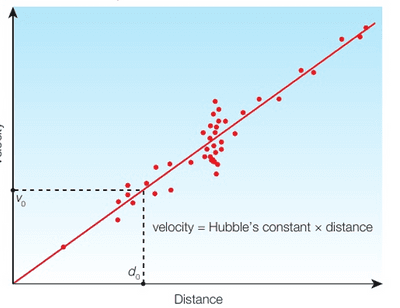
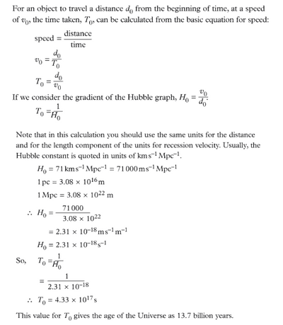

## Hubble's Law

* According to Hubble's Law, the recession velocity of a galaxy is directly proportional to its distance away from us. The constant of proportionality, the Hubble constant, can be found in the gradient of the graph.

**The formula represents this:**

$$

v = H_0d

$$

* The best modern value is considered accurate to within 5%.

$$

H_0 = 71 km^{-1} Mpc^{-1}

$$

* With an accurate value for $H_0$, astronomers can now use Hubble’s law to determine distances to newly observed objects.

### **Age of the Universe**

* As all distant objects show a redshift, they move away from us. This implies that the Universe as a whole is expanding. If we imagine time running backwards from the present, then the Universe would contract until a moment when everything is in the same place.
* This would be the time of the Big Bang when everything first exploded outwards from that single point. Thus, if we can find the Hubble constant, it will tell us how quickly the Universe is expanding.

