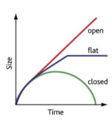
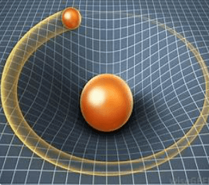
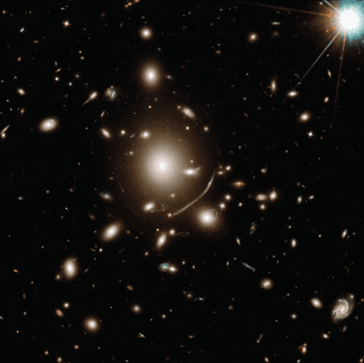

## The Fate of the Universe

* As we know, our universe keeps on expanding

* Gravity could slow down this expansion and put it to a stop, possibly even causing the Universe to contract back inwards, ending in a Big Crunch

* With a high density, the universe implodes into a Big Crunch; with a small density, it will expand forever. When cosmologists try to estimate the average density of matter in the universe, they discover problems. **Some of these problems are:**

  * Difficulty in making accurate measurements of distance to galaxies
  * Hubble constant has a large uncertainty or age = $\frac{1}{H}$ may not be valid as gravity is changing the expansion rate
  * Because of the existence of dark matter
  * Values of the average density/mass of the universe have a large uncertainty
  * Dark energy may mean we don’t understand gravity as well as we thought we did (so it’s hard to predict how gravity will determine the ultimate fate.

* If the universe's density is less than the critical density, the universe will keep expanding indefinitely forever. This universe would be called an open universe.

* If the universe's density is equal to the critical density, the universe will, at one point, stop expanding and maintain a fixed size. This universe would be called a flat universe.

* If the universe's density is greater than the critical density, the universe will collapse into a big crunch. This universe will be known as a closed universe.

### **Dark Matter**

* A material in the Universe that explains some anomalous behaviours of galaxies; as yet, its nature has not been identified
* In astronomy, **dark matter** is a hypothetical form of matter that appears not to interact with light or the electromagnetic field.

### **Gravitational Lensing**

* **Albert Einstein's** theory of general relativity says that matter curves the fabric of spacetime. As a result, any light passing through that curve will curve, too.

* The most famous example: Imagine a bowling ball sitting at the centre of a trampoline, with the bowling ball acting as a massive object (like a galaxy) and the trampoline fabric acting as spacetime. If you put a golf ball in the role of light and roll that golf ball toward the bowling ball, it won't take a straight path. Instead, it'll follow the curve in the trampoline and become "bent" by the presence of the bowling ball.

* That's what light does around massive objects: the more massive the object, the deeper the sag in the trampoline, and the more the light will bend around it.

* Lenses refract, i.e. bend light, and gravity does the same thing, hence the name - lensing.

* Astronomers can verify the existence of dark matter using gravitational lensing.

* Although astronomers cannot see dark matter, they can detect its influence by observing how the gravity of massive galaxy clusters, which contain dark matter, bends and distorts the light of more distant galaxies located behind the cluster.

