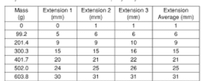
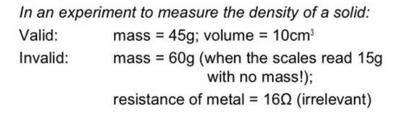
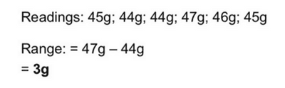
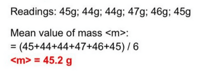
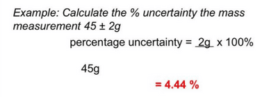
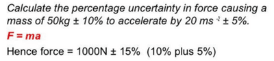
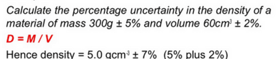
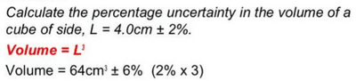

## Important Answering Techniques and Keywords

**Significant Figures:**

* Any non-zero digit is significant
* A zero is only significant if it has a digit to its left
  * 203 - 3 s.f.
  * 023 - 2 s.f.
  * 0.0034 - 2 s.f.
  * 0.00340 - 3 s.f.

**How to Construct A Table:**

 

* Headings should be clear.
* State the physical quantities and their units.
* The measurements from every trial are to be recorded, not just the average value.
* Use the correct number of significant figures and ensure consistency throughout the data.
* The average should always have the same significant figures as the measured values.

**Know the difference between accuracy, sensitivity and precision:**

* Accuracy - refers to how closely a measured value is to the actual value
* Precision - refers to how closely individual, repeated measurements agree with each other
* Sensitivity - refers to the smallest change in an input signal that can cause the measuring device to respond, i.e. the output reading per unit input quantity.
  * A 20mA multimeter is ten times more sensitive than a 200mA multimeter

**Reliability and Validity**

* Reliability: Each time the measurement is taken, the data values obtained are consistent with one another
* Validity: Measurements are of the required data or can be used to give the required data

   

**Types of Errors:**

* Systematic Errors: These are usually caused by poor measurement techniques and are typically related to wrongly calibrated measuring instruments.

  e.g. Zero Error
* Random Error: Errors in readings shown by readings that vary randomly with no recognisable trend

**Important Calculations**

* Range of Measurements:
  * Range = Difference between largest and smallest reading

     
* Mean value:
  * Mean = Total of All Values / Number of Values

 

* **Uncertainty:**
  * Uncertainty = Half of The Range
  * Expressed with the symbol ± before it
* **Percentage Uncertainty:**
  * % Uncertainty = ( Uncertainty / Average Value ) x 100%

 

* Combining Percentage Uncertainties:
  * Products: Add up percentage uncertainties

     
  * Quotients: Add up percentage uncertainties

     
  * Powers: Multiply percentage uncertainty by the number of the power

     

