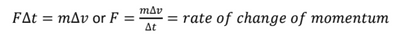

# Core Practical 9

## The Relationship Between The Force Exerted and the Change of Momentum

**According to Newton’s Second Law, the change rate of an object's momentum is directly proportional to the resultant force and acts in the direction of the resultant force. The formula shows this:**

$$

F \Delta t = \Delta p

$$

**Equipment:**

*  Linear air track

* Air blower

* Rider

* Two light gates

* Pulley suitable for fixing to the air track

* Thread

* Set of slotted masses

**Precautions:**

* Place a padded box beneath the load so the floor and masses are not damaged.
* To avoid injuries to feet, do not stand under falling masses.

**Procedure:**

1. Measure the length of the card.

2. Measure the mass of the trolley.

3. Carry out the experiment for a particular force and record t1, t2, and

   ∆t, which is the difference between t2 and t1.

4. Repeat the experiment several times for the same force and calculate the average.

5. Repeat the experiment to increase the magnitude of forces at 0.1N intervals.

6. We need to think carefully about m. The force, which is the weight of the masses hanging over the pulley, has to accelerate the combined mass of the trolley, the masses on the trolley and the masses hanging over the pulley. To vary the force and at the same time m keep it constant, we have to take one of the masses off the trolley and add it to the load each time.

**Calculations:**

1. Calculate the velocity of the trolley when passing through the first light gate and the second one using
   * v = length of card/time taken
2. Then, using the velocities, calculate the change in momentum
3. The change in momentum is then $\Delta p = m(v2 − v1) = m\Delta v$,  where m is the mass being accelerated.

**Graph:**

* Plot a graph of $\Delta F t$ against $\Delta v$
* The straight line graph through the origin shows that $Delta v \propto F$.

