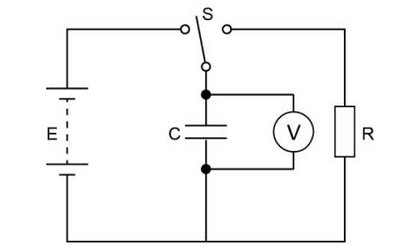
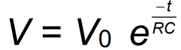
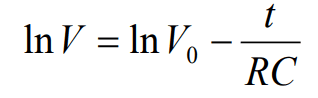

# Core Practical 11

## Use an Oscilloscope or Data Logger to Display and Analyse the Potential Difference Across a Capacitor As It Charges and Discharges through a Resistor

**Introduction:**

* In this experiment, we will be determining the capacitance of a capacitor using the values of potential difference measured in our circuit. You will need to know how to convert values into their logarithmic form, particularly learning how to use the formula for resistor-capacitor discharge.

1. Set up the circuit shown in the diagram above
2. Use a battery pack that has an emf of 10V and use a 10kΩ resistor
3. Connect the switch to the left circuit, which has the battery, to charge up the capacitor
4. After the capacitor is fully charged, connect the switch to the  circuit on the right so that the capacitor discharges through the resistor
5. By using a stopwatch, In intervals of 10 seconds, record the potential difference across the capacitor by referring to the voltmeter
6. Repeat the experiment to obtain repeat readings for the potential difference since the values tend to fluctuate

**Calculations:**

* By converting it into logarithmic form, we get the formula:

  

* As you may notice, we can compare this graph to ***Y=mX+C***

  * $y=ln(V)$

  * $x = t$

  * gradient = $\frac{-1}{RC}$

  * c = $ln(V_0)$

    1. Plot a graph of $ln(V)$ against $t$ and draw a line of best fit
    2. Calculate the gradient (this should be a negative value)
    3. The capacitance of the capacitor is equal to:  $  \frac{1}{R \cdot gradient}$

**Safety:**

1. Keep water or any fluids away from the electrical equipment
2. Make sure no wires or connections are damaged
3. Only remove capacitors until they have fully discharged