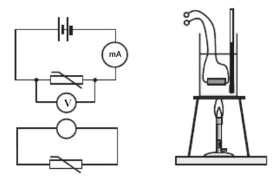
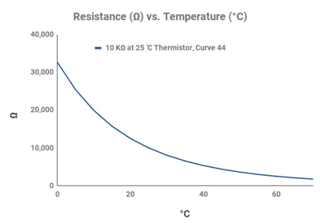

# Core Practical 12

## Calibrating a Thermistor

**Introduction:**

* A thermistor is also known as a negative coefficient thermistor. This means that the resistance across the thermistor increases as the temperature decreases.
* To investigate this relationship, we need a method to vary the temperature across the thermistor. Of course, there are many ways to do this, but the most standard way is to use an ice and water bath.

**Procedure:**

1. Set up the circuit as shown in the diagram
2. The thermistor is immersed in a water bath that is heated with a Bunsen burner
3. An ice bath is used to reach lower temperatures, such as 0°C
4. Vary the temperatures to 0, 10, 20, 30, 40, 50, 60, 70, and 80°C
5. For each of these temperatures, measure the corresponding current shown by the milliammeter and the voltage shown by the voltmeter.

**Calculations:**

1. Using the equation $V=IR$, calculate the value of resistance using  $\frac{V}{I}$
2. Plot a graph of Resistance $\frac{V}{I}, \Omega $ (y axis)  against  temperature °C (x axis)
3. The thermistor is now calibrated, and you can use the temperature graph to find the resistance at a given temperature.

**Safety:**

* Check the voltage limit of the thermistor and stay within the guidelines
* Be careful with the high temperature of the water bath. Do not scald yourself.