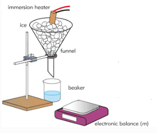

# Core Practical 13

## Specific Latent Heat

**Introduction:**

* Specific Latent Heat is the amount of heat energy required to change the phase of 1kg of a substance without a change in temperature. In this experiment, we will investigate the latent heat of fusion of ice

**Procedure:**

1. Set up the experiment as shown in the diagram above
2. Place the ice in the funnel and allow the ice to warm up to 0 °C. You will need to catch the melted ice in a beaker
3. Determine the mass $m_0$ of the empty and dry beaker
4. Put approximately 100 cm$^3$ of water in the beaker and determine the mass $m_1$ of the beaker plus the water. Measure the temperature $\theta_1$ of the water.
5. Add approximately 20 g of ice at 0 °C to the beaker. Stir until the ice melts.
6. Record the lowest temperature $\theta_2$ reached by the ice and water mixture. This will occur as the last of the ice melts.
7. Determine the mass $m_2$ of the beaker, plus water, plus melted ice

**Calculations:**

1. Calculate the mass $m_w$ of the water, where $m_w = m_1 – m_0$.

2. Calculate the mass, m$_i$ of the ice, where $m_i = m_2 -  m_1$

3. Assume that the temperature of the ice when it was added to the water was 0 °C. The specific heat capacity c of water is 4.20 J ${g}^{-1}  °C^ {–1} $  .

4. To calculate the specific latent heat $L$ of ice, consider the heat balance where heat lost by cooling water = heat gained by ice and warming melted ice

   $m_w \times c \times (\theta_1 – \theta_2) = (m_i \times  L) + (m_i \times c \times (\theta_2 – 0)$ Calculate a value for $ L$

**Safety:**

* A counterweight or G-clamp must be used to avoid the stand toppling over