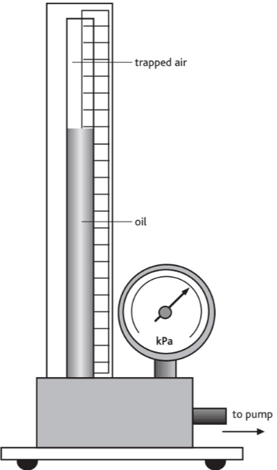
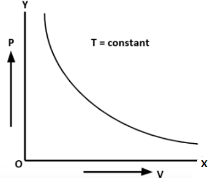

# Core Practical 14

## Investigate the Relationship between the Pressure and Volume of a Gas at Fixed Temperature

**Introduction:**

* This experiment is related to Boyle’s Law, which states that  *P$1$V$*$=P$*{2}$V$*$

**Procedure:**

1. Use the special apparatus shown in the diagram.
2. Using the bicycle pump, pump up the oil until the volume of trapped air is less than half the original value, as shown on the vertical scale. Record the pressure (p) and volume (V).
3. The tube containing the air can be taken as having a uniform bore, so the length of the trapped air column is proportional to its volume.
4. Slowly reduce the pressure by opening the valve at the base of the apparatus after disconnecting the pump.
5. Close the valve after the oil level has fallen, wait for any excess oil to drain down the sides, and then take another reading of p and V.
6. Repeat the procedure to gain as many readings as possible as the pressure of the trapped air, and therefore the oil level, falls.
7. Take air temperature readings next to the apparatus to ensure it does not alter significantly during the experiment.

**Calculations:**

1. Plot a graph of p against V

2. Deduce the relationship between the pressure and volume of a gas at a constant temperature.

\
**Safety:**

* The apparatus should include a protective plastic screen around the glass tube. However, a safety screen is advisable.
* Do not increase the pressure to more than 300 kPa