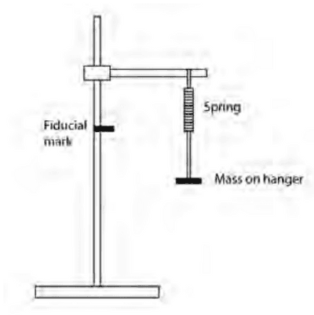

# Core Practical 16

## Determine the Value of an Unknown Mass using the Resonant Frequencies of the Oscillation of Known Masses

**Introduction:**

* In this experiment, we will measure the resonant frequency of masses on a spring. The graph of the results to determine an unknown mass by measuring its resonant frequency when on the spring.
* A spring obeys Hooke’s law, $F = kx$ where $F$ is the force applied, and $x$ is the consequent extension.
* When a mass $m$ is hung on a spring, it is related to the extension by $m = kx g$
* It oscillates with a resonant period T when subsequently pulled down and released. You are to find an expression relating $m$ and $T$.

**Procedures:**

1. Attach a 100g mass on the spring
2. On the stand, make a clear fiducial mark about 5 cm below the bottom of the spring.
3. Extend the spring so the bottom is level with the fiducial marker, release and start timing.
4. Measure time for 10 oscillations
5. Repeat with the same mass two more times
6. Find the average time period of one oscillation
7. Add 100 g and adjust the fiducial mark downwards so that it is 5 cm below the new level of the spring
8. Repeat steps 3-7 until the total mass is 500 g
9. Plot a graph of $T^{2}$ on the y-axis against $m$ on the x-axis

**Calculations:**

Angular velocity,

$\omega =\sqrt{\frac{k}{m}}$  ----- (1)

Where k = spring constant ($N kg^{−1}$) and $m = mass (kg)$

$\omega = 2\pi f$ ----- (2)

Where $f$ = frequency of oscillations $(Hz)$

Frequency, $f = \frac{1}{T}$ ---- (3)

Where $T$ = time period for one oscillation $(s)$

Sub equation (2) into equation (1) :

$\sqrt{\frac{k}{m}}  =  2\pi f$

Sub equation (3) into equation (2) :

$\frac{2\pi}{T} = \sqrt{\frac{k}{m}}$

Square both sides:

$\frac{4\pi^{2} }{T^{2} } = {\frac{k}{m}}$

Make $T^2$ the subject:

$T^2 = m(\frac{4\pi^{2} }{k})$

Plot a graph of $T^2$ on the y-axis against $m$

∴$gradient  = (\frac{4\pi^{2} }{k})$

**Safety:**

* Clamp the stand to the desk to prevent it from falling
* Do not overload the spring so it does not break and cause harm